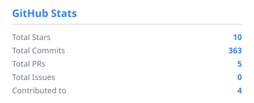
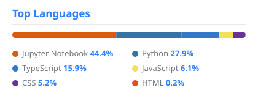

<h1 align="center">Hi, I'm Anas Hasan 👋</h1>

  <b>AI / Backend Engineer</b> · M.Tech CSE @ Punjab Engineering College 
  I build agentic AI systems, RAG pipelines and the backend infrastructure around them.

  
  
  
  

 

  
  
  
  
  
  
   
  
  
  
  
   
  
  
  
  
  
  
  
  
  
  

 

  
  

 

  
  
  

